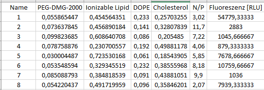

# Data-Driven-LNP-Engineering-for-Dendritic-Cell-mRNA-Delivery-From-DoE-to-Bayesian-Optimization
A Python based mixture aware bayesian optimization algorithm for LNP formulation optimization based on Botorch.

# Description
This repository contains all code used in our study.

- Abstract
- Requirements
- Installation guide
- Usage
- Inputrequirements and Tips
- How to cite
- License

# Abstarct


# Requirements
The code base uses Python 3.10 and primarily depends on:

- BoTorch==0.13.0
- Gpytorch==1.14
- Torch 2.4.0
- Scipy==1.11.3

for a more detailed list feq the requiremnts.txt file

The code base was tested on Windows 10 Enterprise version 22H2

# Installation guide
Before starting, esnure you have Anaconda and Git installed on your system.

1. Clone the repository
````
git clone https://github.com/Fabian-Link/Data-Driven-LNP-Engineering-for-Dendritic-Cell-mRNA-Delivery-From-DoE-to-Bayesian-Optimization
````

2. Navigate to the cloned directory
````
cd <directory path>
````

3. Create a virtual enviroment
````
conda create --name <eviroment name> python=3.10
````

4. Activate the virtual enviroment
````
conda activate <enviroment name>
````

5. Install dependencys
````
pip install -r requirments.txt
````

# Usage

**configure yaml**
- Edit configs/bounds.yaml (mixture labels & bounds, N/P range).
- Edit configs/design.yaml (Sobol size / replicates).
- Edit configs/model.yaml (training steps / lr, optional noise prior).
- Edit configs/acquisition.yaml (LogNEI/LogEI/PI/UCB & optimizer settings).
- Edit configs/paths.yaml for where inputs/outputs live.

Column contract for data: Your raw Excel must include
PEG-DMG-2000, Ionizable Lipid, DOPE, Cholesterol, N/P, Fluoreszenz [RLU].
Mixture rows should sum ≈ 1. If your Excel uses commas as decimals, save with . or tweak utils/load.py to use decimal=",".

**Create an inital design**
````
python scripts/design_generate.py
````

This writes Sobol/DOE candidate tables to results/design/ and figures to results/figures/.
Pick a design (e.g., best_sobol_samples.csv) and run those experiments to obtain responses.

**Record experimental results (warm start)**
- Put a copy of your results Excel in data/raw/ with the six required columns in the exact order above.
- Point configs/paths.yaml:data.train_excel to that file (e.g., data/raw/MyWarmStart.xlsx).

Example raw Excel preview:



**Fit the GP on your warm-start data**
````
python scripts/fit_gp.py
````
This will:
- Clean & transform data, saving data/processed/train_alr_np.csv.
- Train the GP and save results/models/gp_state_dict.pt.
- Write diagnostics & plots:
- Tables: results/tables/gp_training_history.csv, gp_hyperparams.csv, gp_metrics.json, gp_exploitation_optimum.csv
- Figures: loss, hyperparameters, parity (with R²), variance-vs-distance, 1D profiles at dataset mean & GP optimum, 2D pairwise contours.

**Propose the next batch (Bayesian step)**
````
python scripts/propose_candidates.py
````
Uses your trained GP and configs/acquisition.yaml to suggest the next batch.
Outputs a CSVs under results/candidates/:

- candidates_(Acquisition function)_(Date).csv

**Iterate**
- Run the proposed batch in the lab.
- Append the new rows (same six columns) to your original warm-start Excel in data/raw/.
- Re-run:
````
python scripts/fit_gp.py
````
````
python scripts/propose_candidates.py
````
-Repeat until the batch value gain flattens / proposals stabilize, or you’re satisfied.

At any time you can also consult results/tables/gp_exploitation_optimum.csv for the current “best” (pure-exploitation) LNP formulation.

# Notes
- The 4th mixture label in bounds.yaml:mixture_labels is used as the ALR denominator—keep that ordering consistent with your data.

- You can switch acquisition policies (e.g., LogNEI ↔ UCB) or batch size (optimization.q) via configs/acquisition.yaml without touching code.

# Configuration (YAML)

All high-level settings live in configs/. You can adjust these without touching code.

**bounds.yaml — design space (required)**
- mixture_labels (list of 4): Must match the four mixture column names in your Excel in this order.
Important: the 4th label is the ALR denominator (we compute log(x1/x4), log(x2/x4), log(x3/x4)).

- L_bounds, U_bounds (length-4 lists of floats): Per-component lower/upper limits.
Must satisfy: 0 ≤ L_i ≤ U_i ≤ 1, and sum(L_bounds) ≤ 1 ≤ sum(U_bounds).

- np_min, np_max (floats): Allowed N/P range (np_min < np_max).

- projection_matrix (4×3, optional): Controls 3D plotting of the mixture simplex.

- doe (optional list of 4-tuples): DOE points (each row should sum ≈ 1); used for plotting comparisons.

**acquisition.yaml — BO policy & optimizer**
- acquisition.name: One of LogNEI, LogEI, PI, UCB.

- acquisition.beta: Only used if name: UCB (positive float).

- optimization.q: Batch size (int ≥ 1).

- optimization.num_restarts, optimization.raw_samples, optimization.mc_samples: Affect quality/speed of acqf optimization (higher = slower, usually better).

**model.yaml — GP + training**
- noise_prior.use: true/false.

- noise_prior.alpha, noise_prior.beta: Gamma prior on noise variance (positive floats). If use: true, both training and proposing use the same prior (ensures state-dict compatibility).

- train.lr, train.steps: Adam learning rate and iteration count.

- (optional) dtype: double|float, device: cpu|cuda, seed: int.

**paths.yaml — I/O locations**
- results.figures_dir, results.tables_dir, results.design_dir, results.candidates_dir, results, models_dir: Output folders (created if missing).

- data.train_excel: Path to your raw Excel (must include columns: the 4 mixture_labels, plus N/P, and Fluoreszenz [RLU]).

- (optional) data.processed_csv: Where the ALR+N/P training table is saved/loaded.

**design.yaml — sampling for initial designs (optional)**
- num_sobol_samples (int ≥ 1): Points per replicate.

- n_replicates (int ≥ 1): Number of Sobol replicates for discrepancy screening.

**Hard assumptions (do not change unless you refactor):**

- Exactly 4 mixture components; the 4th is the ALR denominator.

- Column names in your data must match mixture_labels, plus N/P and Fluoreszenz [RLU].

**Typical safe edits:**

- Tighten mixture/N/P bounds in bounds.yaml.

- Switch acquisition (e.g., name: LogNEI → UCB + beta: 0.05).

- Adjust batch size or optimizer restarts in acquisition.yaml.

- Enable/disable noise prior or tweak alpha/beta in model.yaml.

- Point paths.yaml to a different dataset or output folder.

# How to cite


# License
All code is under MIT license